# Valtek Optima → SaaS multi-cliente

Hoy la app es un solo `index.html` que guarda todo en `localStorage`: no hay seguridad real, el QR es falso y no se envían correos. El plan la convierte en un SaaS donde cada cliente (colegio, universidad o mall) es una **organización** con sus propios **módulos activados**, usuarios, datos y archivos aislados.

## User Review Required

> [!IMPORTANT]
> **Stack propuesto:** Supabase (Postgres + Auth + Storage + Edge Functions), frontend con Vite en JS vanilla (reutiliza el código actual), Cloudflare Pages para el hosting y Resend para los correos. No hay un servidor propio que mantener: la lógica sensible vive en Edge Functions y en políticas RLS de la base de datos.

> [!WARNING]
> - **Vercel Hobby prohíbe el uso comercial** y GitHub Pages no está pensado para SaaS. Por eso propongo Cloudflare Pages, que es gratis y permite uso comercial.
> - **Supabase Free pausa el proyecto tras 7 días sin actividad** y no incluye backups. Sirve para desarrollar y pilotear, pero con el primer cliente que pague hay que pasar a Pro (USD 25/mes).

> [!CAUTION]
> El demo actual se mantiene intacto en `/demo` durante la migración, para que sigas mostrándolo a los colegios.

## Open Questions

1. **Frontend:** ¿mantenemos JS vanilla con Vite, que permite migrar por partes reutilizando el código (recomendado), o reescribimos en React/Next.js, que tarda más pero escala mejor con un equipo?
2. **QR para alumnos y personal:** ¿QR **rotativo** en el celular, que cambia cada 30 s y no sirve como captura de pantalla (recomendado, cumple lo de "incompartible"), o QR fijo impreso en la credencial?
3. ¿Ya tienes **cuenta en Supabase** y el **dominio .cl** comprado? Si no, ¿qué nombre quieres? (ej. `valtekoptima.cl`)
4. ¿La empresa factura con **RUT de empresa** o como persona natural? Afecta a quién figura como titular del dominio.

---

## 1. Servicios: qué incluye el plan gratis

| Servicio | Uso | Tier gratuito | Cuándo pagar |
|---|---|---|---|
| **Supabase** | Base de datos, login, archivos, funciones | 500 MB de BD, 1 GB de archivos (máx. 50 MB por archivo), 50.000 usuarios activos al mes, 5 GB de transferencia, 2 proyectos, Edge Functions incluidas | Pro USD 25/mes: 8 GB de BD, 100 GB de archivos, backups diarios, sin pausa |
| **Cloudflare Pages** | Hosting del frontend | Ancho de banda ilimitado, 500 builds/mes, HTTPS, uso comercial permitido | Casi nunca |
| **Cloudflare R2** (opcional) | Archivos muy pesados (videos) | 10 GB gratis, sin costo por descarga | USD 0,015 por GB al mes |
| **Resend** | Correos con QR | 3.000/mes, 100/día, 1 dominio | USD 20/mes: 50.000 correos |
| **Cloudflare Turnstile** | Anti-bots en el formulario público | Gratis | — |
| Firebase (alternativa) | — | Firestore 1 GB; **Storage y Functions ahora exigen el plan Blaze** (con tarjeta) | Descartado: es NoSQL, peor para permisos multi-cliente |
| Render / Railway (alternativa) | Backend Node propio | Render se "duerme" tras 15 min y su Postgres gratis vence a los 30 días; Railway da USD 5 de crédito | Solo si se necesita un servidor propio |

> [!NOTE]
> Los límites cambian seguido. Hay que verificarlos en cada sitio antes de contratar.

**Costo para partir: ~$10.000 CLP al año (dominio). Con clientes pagando: ~USD 25–45 al mes.**

---

## 2. Base de datos (Postgres multi-cliente)

Toda tabla de negocio lleva `org_id`. Postgres aplica el aislamiento por RLS (Row Level Security): aunque el frontend tenga un bug, un colegio nunca ve datos de otro.

```mermaid
erDiagram
  organizations ||--o{ org_modules : tiene
  organizations ||--o{ sites : tiene
  organizations ||--o{ memberships : tiene
  profiles ||--o{ memberships : pertenece
  sites ||--o{ zones : contiene
  zones ||--o{ cleaning_logs : registra
  organizations ||--o{ people : registra
  people ||--o{ contractor_documents : sube
  organizations ||--o{ events : crea
  events ||--o{ event_registrations : recibe
  people ||--o{ event_registrations : se_inscribe
  people ||--o{ credentials : posee
  sites ||--o{ gates : tiene
  gates ||--o{ access_logs : registra
  credentials ||--o{ access_logs : usada_en
```



| Tabla | Campos clave |
|---|---|
| `organizations` | id, name, **type** (`colegio`/`universidad`/`mall`/`empresa`), rut_empresa, plan, status, logo_path |
| `org_modules` | org_id, **module** (`aseo`/`acceso`/`contratistas`/`eventos`), enabled, config jsonb |
| `sites` | id, org_id, name, address (sedes, campus o edificios del mall) |
| `profiles` | id (= auth.users.id), full_name, rut, phone, **is_superadmin** |
| `memberships` | user_id, org_id, **role** (`org_admin`/`guard`/`cleaning_supervisor`/`operator`/`provider`), site_id |
| `zones` | id, org_id, site_id, name, type, floor, assigned_to |
| `cleaning_logs` | id, org_id, zone_id, worker_id, started_at, finished_at, diagnostic, comment, photo_before_path, photo_after_path |
| `people` | id, org_id, **rut** (normalizado, único por org), full_name, email, phone, **person_type** (`alumno`/`apoderado`/`personal`/`visitante`/`contratista`) |
| `contractor_documents` | id, org_id, person_id, doc_type, file_path, expires_on, status |
| `events` | id, org_id, site_id, name, starts_at, ends_at, **status** (`pendiente_aprobacion`/`aprobado`/`rechazado`), created_by, approved_by, requires_guest_approval, **public_slug** |
| `event_registrations` | id, org_id, event_id, person_id, status, consent_at, id_front_path, id_back_path, selfie_path |
| `credentials` | id, org_id, person_id, event_id (null = permanente), **kind** (`evento`/`permanente`), **secret** (para el QR rotativo), valid_from, valid_until, status (`activa`/`revocada`) |
| `gates` | id, org_id, site_id, name, kind (`puerta`/`torniquete`), stage (1/2), controller_ref |
| `access_logs` | id, org_id, gate_id, credential_id, person_id, **direction** (`in`/`out`), result, reason, scanned_by, created_at |

**Restricciones importantes en la BD:**
- Índice único parcial: una sola tarea `en proceso` por operario (`finished_at IS NULL`).
- `UNIQUE (event_id, person_id)`: nadie se registra dos veces al mismo evento.
- `UNIQUE (org_id, rut)` en `people`, con validación del dígito verificador (módulo 11) en una función SQL.

**Permisos:** funciones SQL `is_superadmin()`, `has_role(org, roles[])` y `org_has_module(org, module)` que usan todas las políticas RLS. Los módulos se bloquean en la BD, no solo ocultando botones.

**Archivos (Storage):** buckets privados `evidencias`, `documentos` y `acreditaciones`, con rutas `{org_id}/{...}`, políticas por organización y URLs firmadas que duran 5 minutos. Las fotos se comprimen en el navegador antes de subir (reutilizando el `resizeImage` actual).

---

## 3. Autenticación y roles

- **Supabase Auth**: guarda las contraseñas con **bcrypt**, emite **JWT** con renovación automática y permite recuperar la contraseña por mail.
- Un hook de Auth agrega `org_id` y `role` al JWT, para no consultar los permisos en cada pantalla.
- Un usuario puede pertenecer a varias organizaciones (ej. un guardia de una empresa externa); al entrar elige la organización.
- El superadmin no tiene contraseña en el código: es un usuario normal con `is_superadmin = true`.

| Rol | Permisos |
|---|---|
| SuperAdmin | Crea organizaciones, activa módulos, ve todo |
| Administrador de cliente (directora / admin del mall) | Usuarios de su org, aprueba eventos y visitantes, reportes |
| Supervisor de aseo | Zonas, asignaciones, monitoreo, informes |
| Operario | Solo sus zonas y sus registros |
| Guardia / Portería | Escanear, ver resultado, registrar entrada y salida |
| Proveedor | Sus trabajadores externos y sus documentos |

---

## 4. Módulo QR basado en RUT

> [!IMPORTANT]
> **El QR no lleva el RUT a la vista.** Hoy el token es el RUT mismo, así que cualquiera puede fabricar un QR válido. El nuevo QR va firmado criptográficamente.

**Formato:** `VO1.<payload base64url>.<firma Ed25519>`
- Payload: `{ cid: credential_id, org: org_id, exp: vencimiento }`. El RUT queda en la BD, ligado a `cid`.
- **Visitantes de evento:** QR fijo firmado que vence al terminar el evento. Llega por correo como imagen PNG.
- **Alumnos y personal:** QR **rotativo** dentro de la app (el `cid` más un código tipo TOTP que cambia cada 30 s). Una captura de pantalla deja de servir en segundos.

**Flujo:**
1. La directora crea el evento (`pendiente_aprobacion`) → lo aprueba → el sistema genera `public_slug` → link `valtekoptima.cl/r/{slug}`.
2. La persona llena el formulario (RUT validado con módulo 11, Turnstile, consentimiento y fotos) → `event_registrations`.
3. Al aprobarse (automático o manual, según `requires_guest_approval`), la Edge Function `issue-credential` crea la credencial, firma el QR y **Resend envía el correo** con el QR adjunto.
4. El guardia abre `/porteria` en cualquier celular. Usa la cámara (requiere HTTPS), lee el QR y llama a la Edge Function `validate-access`.
5. `validate-access` verifica firma → credencial activa → organización con módulo `acceso` → evento hoy y en horario (**hora de Chile, no UTC**) → puerta autorizada → etapa P1 antes de P2 → anti-passback (no entra dos veces seguidas sin salir). Registra en `access_logs` y responde en menos de 300 ms con pantalla verde o roja, nombre y foto.
6. Si el celular pierde conexión, puede verificar la firma con la clave pública, y los registros se sincronizan después.
7. **Fase posterior:** la misma función responde al controlador ZKTeco C3 o al torniquete para abrir sin intervención del guardia.

---

## 5. Estructura de archivos y dependencias

```
san-nicolas-aseo/
├── valtek-optima/               # app nueva (Vite)
│   ├── index.html               # shell mínimo
│   ├── package.json  vite.config.js  .env.example
│   ├── public/demo/index.html   # demo actual intacto (movido)
│   └── src/
│       ├── main.js  router.js
│       ├── lib/  supabase.js  auth.js  modules.js  rut.js  qr.js  storage.js
│       ├── styles/  tokens.css  components.css  views.css   # extraídos del <style> actual
│       └── views/
│           ├── landing.js  login.js
│           ├── superadmin/  orgs.js  org-onboarding.js  users.js
│           ├── aseo/        operario.js  asignacion.js  monitoreo.js  informes.js
│           ├── acceso/      personas.js  contratistas.js  credencial.js
│           ├── eventos/     lista.js  aprobacion.js  registro-publico.js
│           └── porteria/    scanner.js  historial.js
├── supabase/
│   ├── config.toml
│   ├── migrations/  0001_schema.sql  0002_rls.sql  0003_storage.sql  0004_functions.sql
│   ├── seed.sql                 # San Nicolás de Myra + usuarios de prueba
│   └── functions/  issue-credential/  validate-access/  approve-registration/  send-email/  rotating-qr/
└── .github/workflows/deploy.yml # cambia a: npm ci → build → Cloudflare Pages
```

| Dependencia | Para qué |
|---|---|
| `vite` (dev) | Build y servidor local |
| `@supabase/supabase-js` | Cliente de BD, login y archivos |
| `qrcode` | Generar el QR real (frontend y correo) |
| `html5-qrcode` | Escanear con la cámara del celular |
| `jose` (Edge Functions) | Firmar y verificar el QR (Ed25519) |
| `supabase` CLI (dev) | Migraciones y funciones en local |
| `@marsidev/react-turnstile` ❌ → script de Turnstile directo | Anti-bots |

---

## 6. Fases de implementación

| Fase | Entregable | Resultado verificable |
|---|---|---|
| **0. Base** | Vite + separar CSS/JS en módulos + demo en `/demo` | `npm run dev` levanta la app igual que hoy |
| **1. BD y Auth** | Migraciones, RLS, seed, login real | Un usuario de la org A **no puede** leer datos de la org B (test SQL) |
| **2. Onboarding SuperAdmin** | Crear organización, elegir tipo, activar módulos, crear su admin, subir logo | Un mall sin `acceso` no ve portería ni puede llamar `validate-access` |
| **3. Aseo en BD** | Zonas, asignación, marcado con fotos a Storage, informes | Datos persisten entre dispositivos |
| **4. Eventos + QR + correo** | Aprobación de evento, link público, registro, credencial firmada, correo Resend | Llega un mail real con un QR escaneable |
| **5. Portería** | Scanner con cámara, P1/P2, entrada/salida, historial en vivo | Se escanea desde otro celular y se ve el resultado en el panel |
| **6. Lanzamiento .cl** | Dominio, DNS, deploy, checklist | `https://valtekoptima.cl` operativo |
| 7. (después) | QR rotativo para alumnos, integración ZKTeco, app PWA instalable | — |

Cada fase termina con un commit y un push a la rama **`juanjo`**.

---

## 7. Lanzamiento con dominio .cl

**Lo haces tú (te guío pantalla por pantalla):**
1. **NIC Chile** (nic.cl): crear una cuenta con tu RUT o el de la empresa → buscar el dominio → pagar con Webpay (~$10.000 CLP/año).
2. **Cloudflare** (gratis): agregar el dominio → copiar los 2 *nameservers* que entrega → en NIC Chile, "Modificar servidores DNS" y pegarlos. Tarda entre minutos y 24 h.
3. **Resend**: agregar el dominio → copiar sus registros TXT (SPF, DKIM) y MX a Cloudflare → verificar. Sin esto, los correos llegan a spam.
4. Pasarme las claves: URL y `anon key` de Supabase, `service_role key` (solo para las funciones) y la API key de Resend.

**Lo hago yo:** conectar Cloudflare Pages al repo → dominio `valtekoptima.cl` y `app.valtekoptima.cl` → variables de entorno → registro DMARC → deploy automático en cada push a `juanjo`.

### Checklist de producción
- [ ] RLS activo en **todas** las tablas, con test de aislamiento entre organizaciones
- [ ] Sin credenciales en el código; `.env` en `.gitignore`
- [ ] Turnstile y límite de intentos en el formulario público y el login
- [ ] Buckets privados + URLs firmadas
- [ ] Fechas en la zona horaria `America/Santiago`
- [ ] Política de privacidad y consentimiento según Ley 19.628 y la nueva **Ley 21.719** (vigente desde dic. 2026), con purga que borre también email y fotos
- [ ] Backup: `pg_dump` diario con GitHub Action (Free no trae backups) o plan Pro
- [ ] Correos verificados (SPF/DKIM/DMARC) y probados en Gmail y Outlook
- [ ] Monitoreo de errores (Sentry, plan gratis)
- [ ] Prueba completa en celular real: registro → correo → escaneo P1 → P2 → reporte

## Verification Plan

### Automated Tests
- `supabase db reset` + script SQL de pruebas de RLS: aislamiento entre orgs, bloqueo por módulo, roles.
- Tests de `rut.js` (dígito verificador) y `qr.js` (firma válida, alterada, vencida o revocada) con `vitest`.
- `npm run build` sin errores antes de cada push.

### Manual Verification
- Crear un colegio con todos los módulos y un mall solo con aseo; confirmar que el mall no ve acceso.
- Flujo completo de evento con un correo real y escaneo desde un segundo celular.
- Validar en el navegador que el demo en `/demo` sigue funcionando.
